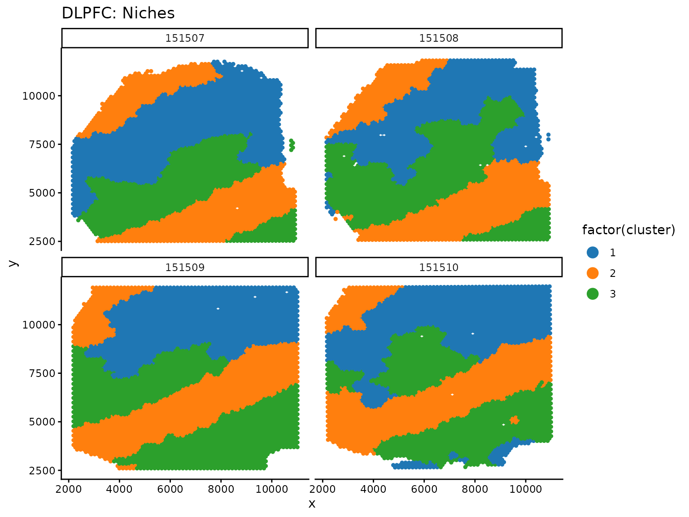
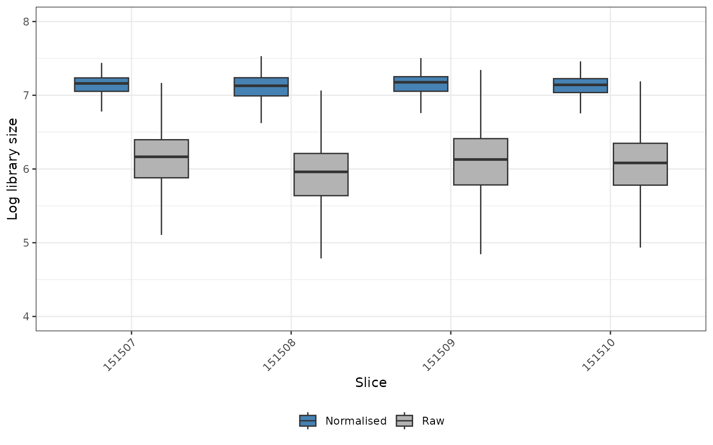

# MultiNorm: Spatially Aware Normalisation of Multi-Slice Spatial Transcriptomics Data

``` r
library(MultiNorm)
```

## Introduction

MultiNorm is a spatially aware normalisation method developed for
multi-slice spatial transcriptomics data. The method accounts for
unwanted variation within and between tissue slices while aiming to
preserve biologically meaningful spatial expression patterns and
signals.

In this vignette, we demonstrate the application of MultiNorm using four
human dorsolateral prefrontal cortex (DLPFC) tissue slices available
through the `spatialLIBD` package.

## Data preparation

### Downloading the example dataset

The DLPFC dataset contains spatial transcriptomics data generated using
the 10x Genomics Visium platform.

The required packages can be installed through Bioconductor.

``` r
if (!requireNamespace("BiocManager", quietly = TRUE))
  install.packages("BiocManager")

BiocManager::install(c("spatialLIBD", "SpatialExperiment"))
```

We first load the required packages and download the dataset as a
SpatialExperiment object.

``` r
library(spatialLIBD)
#> Loading required package: SpatialExperiment
#> Loading required package: SingleCellExperiment
#> Loading required package: SummarizedExperiment
#> Loading required package: MatrixGenerics
#> Loading required package: matrixStats
#> 
#> Attaching package: 'MatrixGenerics'
#> The following objects are masked from 'package:matrixStats':
#> 
#>     colAlls, colAnyNAs, colAnys, colAvgsPerRowSet, colCollapse,
#>     colCounts, colCummaxs, colCummins, colCumprods, colCumsums,
#>     colDiffs, colIQRDiffs, colIQRs, colLogSumExps, colMadDiffs,
#>     colMads, colMaxs, colMeans2, colMedians, colMins, colOrderStats,
#>     colProds, colQuantiles, colRanges, colRanks, colSdDiffs, colSds,
#>     colSums2, colTabulates, colVarDiffs, colVars, colWeightedMads,
#>     colWeightedMeans, colWeightedMedians, colWeightedSds,
#>     colWeightedVars, rowAlls, rowAnyNAs, rowAnys, rowAvgsPerColSet,
#>     rowCollapse, rowCounts, rowCummaxs, rowCummins, rowCumprods,
#>     rowCumsums, rowDiffs, rowIQRDiffs, rowIQRs, rowLogSumExps,
#>     rowMadDiffs, rowMads, rowMaxs, rowMeans2, rowMedians, rowMins,
#>     rowOrderStats, rowProds, rowQuantiles, rowRanges, rowRanks,
#>     rowSdDiffs, rowSds, rowSums2, rowTabulates, rowVarDiffs, rowVars,
#>     rowWeightedMads, rowWeightedMeans, rowWeightedMedians,
#>     rowWeightedSds, rowWeightedVars
#> Loading required package: GenomicRanges
#> Loading required package: stats4
#> Loading required package: BiocGenerics
#> Loading required package: generics
#> 
#> Attaching package: 'generics'
#> The following objects are masked from 'package:base':
#> 
#>     as.difftime, as.factor, as.ordered, intersect, is.element, setdiff,
#>     setequal, union
#> 
#> Attaching package: 'BiocGenerics'
#> The following objects are masked from 'package:stats':
#> 
#>     IQR, mad, sd, var, xtabs
#> The following objects are masked from 'package:base':
#> 
#>     anyDuplicated, aperm, append, as.data.frame, basename, cbind,
#>     colnames, dirname, do.call, duplicated, eval, evalq, Filter, Find,
#>     get, grep, grepl, is.unsorted, lapply, Map, mapply, match, mget,
#>     order, paste, pmax, pmax.int, pmin, pmin.int, Position, rank,
#>     rbind, Reduce, rownames, sapply, saveRDS, table, tapply, unique,
#>     unsplit, which.max, which.min
#> Loading required package: S4Vectors
#> 
#> Attaching package: 'S4Vectors'
#> The following object is masked from 'package:utils':
#> 
#>     findMatches
#> The following objects are masked from 'package:base':
#> 
#>     expand.grid, I, unname
#> Loading required package: IRanges
#> Loading required package: Seqinfo
#> Loading required package: Biobase
#> Welcome to Bioconductor
#> 
#>     Vignettes contain introductory material; view with
#>     'browseVignettes()'. To cite Bioconductor, see
#>     'citation("Biobase")', and for packages 'citation("pkgname")'.
#> 
#> Attaching package: 'Biobase'
#> The following object is masked from 'package:MatrixGenerics':
#> 
#>     rowMedians
#> The following objects are masked from 'package:matrixStats':
#> 
#>     anyMissing, rowMedians
library(SpatialExperiment)

# Download the DLPFC dataset
spe <- spatialLIBD::fetch_data(type = "spe")
#> 2026-11-26 08:25:09.395907 loading file /home/wboyagoda/.cache/R/BiocFileCache/1a0444ceef1df_Human_DLPFC_Visium_processedData_sce_scran_spatialLIBD.Rdata%3Fdl%3D1

# Inspect the dataset
spe
#> class: SpatialExperiment 
#> dim: 33538 47681 
#> metadata(0):
#> assays(2): counts logcounts
#> rownames(33538): ENSG00000243485 ENSG00000237613 ... ENSG00000277475
#>   ENSG00000268674
#> rowData names(9): source type ... gene_search is_top_hvg
#> colnames(47681): AAACAACGAATAGTTC-1 AAACAAGTATCTCCCA-1 ...
#>   TTGTTTCCATACAACT-1 TTGTTTGTGTAAATTC-1
#> colData names(69): sample_id Cluster ... array_row array_col
#> reducedDimNames(6): PCA TSNE_perplexity50 ... TSNE_perplexity80
#>   UMAP_neighbors15
#> mainExpName: NULL
#> altExpNames(0):
#> spatialCoords names(2) : pxl_col_in_fullres pxl_row_in_fullres
#> imgData names(4): sample_id image_id data scaleFactor

# Examine the number of spots in each tissue slice
table(spe$sample_id)
#> 
#> 151507 151508 151509 151510 151669 151670 151671 151672 151673 151674 151675 
#>   4226   4384   4789   4634   3661   3498   4110   4015   3639   3673   3592 
#> 151676 
#>   3460
```

### Preparing individual tissue slices

MultiNorm accepts a named list of SpatialExperiment objects, where each
object represents an individual tissue slice.The spe_list must be
arranged according to the spatial order of the tissue slices.

For this demonstration, we select four tissue slices from the DLPFC
dataset and split the combined SpatialExperiment object into individual
objects.

``` r
# Select four tissue slices
sample_ids = 151507:151510

# Split the combined SpatialExperiment object into individual slices
spe_list <- setNames(
  lapply(sample_ids, function(id) {
    spe[, spe$sample_id == id]
  }),
  sample_ids
)

# Inspect the dimensions of each tissue slice
lapply(spe_list, dim)
#> $`151507`
#> [1] 33538  4226
#> 
#> $`151508`
#> [1] 33538  4384
#> 
#> $`151509`
#> [1] 33538  4789
#> 
#> $`151510`
#> [1] 33538  4634
```

## Data preprocessing

### Quality control

Although more comprehensive quality control procedures can be applied
depending on the characteristics of the dataset, we perform minimal
quality control for demonstration purposes.

Specifically, we remove spots with zero total counts and genes that are
not expressed in any of the selected tissue slices.

``` r
# Remove spots with zero total counts independently from each slice
spe_list_qc <- lapply(spe_list, function(spe) {
  spe[, colSums(counts(spe)) > 0]
})

# Combine count matrices across all tissue slices
combined_counts <- do.call(cbind, lapply(spe_list_qc, counts))

# Identify genes expressed in at least one spot across all slices
keep_genes <- rowSums(combined_counts) > 0

# Retain the same set of expressed genes in all slices
spe_list_qc <- lapply(spe_list_qc, function(spe) {
  spe[keep_genes, ]
})

# Inspect the dimensions before and after quality control
lapply(spe_list, dim)
#> $`151507`
#> [1] 33538  4226
#> 
#> $`151508`
#> [1] 33538  4384
#> 
#> $`151509`
#> [1] 33538  4789
#> 
#> $`151510`
#> [1] 33538  4634
lapply(spe_list_qc, dim)
#> $`151507`
#> [1] 23493  4226
#> 
#> $`151508`
#> [1] 23493  4384
#> 
#> $`151509`
#> [1] 23493  4789
#> 
#> $`151510`
#> [1] 23493  4634
```

### Selection of highly variable genes

To reduce computational requirements for this demonstration, we restrict
the analysis to a subset of highly variable genes (HVGs).

The top 2,000 HVGs are identified independently for each tissue slice
using the `scran` package. We subsequently retain the intersection of
these gene sets to ensure that all tissue slices contain a common set of
highly variable genes.

Log-normalisation is performed temporarily for HVG selection. The
original raw counts are retained for the subsequent application of
MultiNorm.

``` r
library(scran)
#> Loading required package: scuttle
library(scuttle)
library(SpatialExperiment)

# Identify the top 2,000 HVGs independently for each slice
hvg_list <- lapply(spe_list_qc, function(spe) {

  # Temporarily log-normalise counts for HVG selection
  spe <- scuttle::logNormCounts(spe)

  # Model gene-level expression variance
  dec <- scran::modelGeneVar(spe)

  # Select the top 2,000 highly variable genes
  scran::getTopHVGs(dec, n = 2000)
})

# Identify HVGs shared across all tissue slices
common_hvgs <- Reduce(intersect, hvg_list)

# Examine the number of shared HVGs
length(common_hvgs)
#> [1] 890

# Retain the common HVGs in each tissue slice
spe_list_hvg <- lapply(spe_list_qc, function(spe) {
  spe[common_hvgs, ]
})

# Inspect the dimensions after HVG selection
lapply(spe_list_hvg, dim)
#> $`151507`
#> [1]  890 4226
#> 
#> $`151508`
#> [1]  890 4384
#> 
#> $`151509`
#> [1]  890 4789
#> 
#> $`151510`
#> [1]  890 4634
```

Note that HVG selection is performed here to reduce the computational
requirements of the demonstration. Users may choose a different set of
genes depending on their analytical objectives.

## Identification of biologically similar regions

MultiNorm utilises information from biologically similar regions across
tissue slices to help distinguish unwanted variation from genuine
biological differences.

These regions can be identified using existing spatial clustering or
integration methods, such as spatialMNN, BANKSY with appropriate
cross-slice cluster matching, or other suitable methods.

Alternatively, users may provide existing biological annotations, such
as cell-type labels or manually annotated anatomical regions, when
available.

In this demonstration, we use the spatialMNN method to identify
biologically similar regions, referred to here as niches, across the
four DLPFC slices.

### Spatial niche identification

The following helper function converts the SpatialExperiment objects
into Seurat objects, identifies spatial clusters within individual
tissue slices, matches biologically similar clusters across slices, and
transfers the resulting niche annotations back to the original
SpatialExperiment objects.

``` r
library(SpatialExperiment)
library(atlasClustering)
#> Warning: replacing previous import 'dplyr::as_data_frame' by
#> 'igraph::as_data_frame' when loading 'atlasClustering'
#> Warning: replacing previous import 'Seurat::components' by 'igraph::components'
#> when loading 'atlasClustering'
#> Warning: replacing previous import 'dplyr::groups' by 'igraph::groups' when
#> loading 'atlasClustering'
#> Warning: replacing previous import 'DescTools::%c%' by 'igraph::%c%' when
#> loading 'atlasClustering'
#> Warning: replacing previous import 'dplyr::union' by 'igraph::union' when
#> loading 'atlasClustering'
#> Warning: replacing previous import 'circlize::degree' by 'igraph::degree' when
#> loading 'atlasClustering'
#> Warning: replacing previous import 'igraph::normalize' by 'scater::normalize'
#> when loading 'atlasClustering'
library(stringr)
library(Seurat)
#> Loading required package: SeuratObject
#> Loading required package: sp
#> 
#> Attaching package: 'sp'
#> The following object is masked from 'package:IRanges':
#> 
#>     %over%
#> 
#> Attaching package: 'SeuratObject'
#> The following object is masked from 'package:SummarizedExperiment':
#> 
#>     Assays
#> The following object is masked from 'package:GenomicRanges':
#> 
#>     intersect
#> The following object is masked from 'package:Seqinfo':
#> 
#>     intersect
#> The following object is masked from 'package:IRanges':
#> 
#>     intersect
#> The following object is masked from 'package:S4Vectors':
#> 
#>     intersect
#> The following object is masked from 'package:BiocGenerics':
#> 
#>     intersect
#> The following objects are masked from 'package:base':
#> 
#>     intersect, t
#> 
#> Attaching package: 'Seurat'
#> The following object is masked from 'package:SummarizedExperiment':
#> 
#>     Assays

run_niche_mnn <- function(spe_list,r1=1,r2=0.5) {

  # Clean spot-level metadata and remove duplicated gene identifiers

  spe_list <- lapply(spe_list, function(x) {
    cd <- colData(x)

    if ("X" %in% colnames(cd)) {
      colnames(cd)[colnames(cd) == "X"] <- "index"
      colData(x) <- cd
    }

    x <- x[!duplicated(rownames(x)), ]
    return(x)
  })

  # Assign a unique sample identifier to each tissue slice

  for (i in seq_along(spe_list)) {
    colData(spe_list[[i]])$sample_id <- names(spe_list)[i]
  }

  # Define a helper function to convert SpatialExperiment objects
  # into Seurat objects while retaining spatial coordinates and
  # relevant spot-level metadata

  spe2seu_single <- function(spe_obj, sample_name = NULL,
                            sel_assay = "counts", sel_col = "LS") {

    if (is.null(sample_name)) sample_name <- spe_obj$sample[1]

    meta_df <- data.frame(
      barcode = colnames(spe_obj),
      coord_x = int_colData(spe_obj)$spatialCoords[, 1],
      coord_y = int_colData(spe_obj)$spatialCoords[, 2],
      row.names = colnames(assays(spe_obj)[[sel_assay]])
    )

    if (!is.null(sel_col)) {
      for (col in sel_col) {
        meta_df[[col]] <- colData(spe_obj)[[col]]
      }
    }

    seu <- CreateSeuratObject(
      counts = assays(spe_obj)[[sel_assay]],
      project = paste0("spe_", sample_name),
      meta.data = meta_df
    )

    seu <- FindVariableFeatures(seu, verbose = FALSE)
    return(seu)
  }

  niche_spe <- spe_list

  # Convert each SpatialExperiment object into a Seurat object

  seurat_ls <- mapply(
    spe2seu_single,
    niche_spe,
    names(niche_spe),
    SIMPLIFY = FALSE
  )

  # Stage 1: Identify spatial clusters within individual tissue slices

  seurat_ls <- stage_1(
    seurat_ls,
    find_HVG = FALSE,
    top_pcs = 8,
    cor_threshold = 0.6,
    cor_met = "PC",
    edge_smoothing = TRUE,
    nn = 6,
    use_glmpca = TRUE,
    verbose = TRUE,
    cl_resolution = r1
  )

  # Stage 2: Match biologically similar clusters across tissue slices
  # using the MNN-based approach

  rtn_ls <- stage_2(
    seurat_ls,
    cl_key = "merged_cluster",
    rtn_seurat = TRUE,
    nn_2 = 10,
    method = "MNN",
    top_pcs = 8,
    use_glmpca = TRUE,
    rare_ct = "m",
    resolution = r2,
    hvg = nrow(spe_list[[1]])
  )

  # Assign shared MNN-based cluster labels to the Seurat objects

  seurat_ls <- assign_label(
    seurat_ls,
    rtn_ls$cl_df,
    "MNN",
    0.6,
    cl_key = "merged_cluster"
  )

  # Transfer the shared niche annotations back to the original
  # SpatialExperiment objects using spot barcodes

  for (sample_name in names(seurat_ls)) {

    seu <- seurat_ls[[sample_name]]
    clusters <- seu@meta.data$sec_cluster_MNN
    barcodes <- colnames(seu)

    spe_obj <- spe_list[[sample_name]]

    colData(spe_obj)$sec_cluster_MNN <- NA
    colData(spe_obj)[barcodes, "niche"] <- clusters

    spe_list[[sample_name]] <- spe_obj
  }

  return(spe_list)

}
```

We apply the above function to identify biologically similar niches
across the four tissue slices.

``` r
spe_list_hvg = run_niche_mnn(spe_list_hvg)
#> spe_151507 cluster number: 172
#> Warning: Using `size` aesthetic for lines was deprecated in ggplot2 3.4.0.
#> ℹ Please use `linewidth` instead.
#> ℹ The deprecated feature was likely used in the atlasClustering package.
#>   Please report the issue to the authors.
#> This warning is displayed once per session.
#> Call `lifecycle::last_lifecycle_warnings()` to see where this warning was
#> generated.
#> Warning: `aes_string()` was deprecated in ggplot2 3.0.0.
#> ℹ Please use tidy evaluation idioms with `aes()`.
#> ℹ See also `vignette("ggplot2-in-packages")` for more information.
#> ℹ The deprecated feature was likely used in the atlasClustering package.
#>   Please report the issue to the authors.
#> This warning is displayed once per session.
#> Call `lifecycle::last_lifecycle_warnings()` to see where this warning was
#> generated.
#> spe_151507 merged cluster number: 37
#> spe_151508 cluster number: 121
#> spe_151508 merged cluster number: 33
#> spe_151509 cluster number: 72
#> spe_151509 merged cluster number: 30
#> spe_151510 cluster number: 99
#> spe_151510 merged cluster number: 38
#> Elasped Time:
#> 10.4 secs
#> Warning: Data is of class matrix. Coercing to dgCMatrix.
#> Normalizing layer: counts
```

Spots without assigned niche annotations are removed before applying
MultiNorm.

``` r
remove_na_niche <- function(x) {
  lapply(x, function(s) {
    s[, !is.na(s$niche)]
  })
}

spe_list_hvg = remove_na_niche(spe_list_hvg)
```

### Visualising biological niches

Before applying MultiNorm, we examine the spatial distribution of the
identified biological niches across the tissue slices.

The following code extracts the spatial coordinates and niche
annotations from each SpatialExperiment object and combines them into a
single data frame for visualisation.

``` r
data = lapply(names(spe_list_hvg), function(nm) {
  s = spe_list_hvg[[nm]]
  data.frame(
    sample = nm,
    x = spatialCoords(s)[,1],
    y = spatialCoords(s)[,2],
    cluster = s$niche
  )
}) %>% do.call(rbind,.)
```

The resulting spatial plots illustrate the distribution of shared
biological niches across the four tissue slices.

``` r
library(ggplot2)
library(ggsci)

p = ggplot(data, aes(x = x, y = y, color = factor(cluster))) +
  geom_point(size = 1) +
  facet_wrap(~sample) +
  labs(title = "DLPFC: Niches") +
  scale_color_d3() +
  guides(color = guide_legend(override.aes = list(size = 4))) +
  theme_classic()

p
```



## Applying MultiNorm

Following data preprocessing and the identification of biologically
similar regions, we apply MultiNorm to the list of SpatialExperiment
objects.

The `niche_col` argument specifies the column in the spot-level metadata
containing the shared biological niche annotations.

``` r
dlpfc_norm = MultiNorm(
  spe_list_hvg,
  niche_col  = "niche",
  spot_frac  = 0.3,
  df_bio     = c(6,6),
  df_tech    = c(3,3),
  lambdaC    = 10000,
  verbose = TRUE
)
#> Loading v2
#> === Sample SPE Proportional ===
#> NAs detected:                 0 
#> Original cells:               4226 
#> Sampled cells:                1267 
#> === Sample SPE Proportional ===
#> NAs detected:                 0 
#> Original cells:               4384 
#> Sampled cells:                1315 
#> === Sample SPE Proportional ===
#> NAs detected:                 0 
#> Original cells:               4789 
#> Sampled cells:                1436 
#> === Sample SPE Proportional ===
#> NAs detected:                 0 
#> Original cells:               4634 
#> Sampled cells:                1389
#> LS extracted from colData
#> LS extracted from colData
#> LS extracted from colData
#> LS extracted from colData
#> 
#> === Outer iteration 1 ===
#> Step halved 1 times
#> Iter 1 | log-likelihood: -6026593.91
#> Iter 2 | log-likelihood: -5118559.73
#> Iter 3 | log-likelihood: -4527674.53
#> Iter 4 | log-likelihood: -4090334.53
#> Iter 5 | log-likelihood: -3757674.77
#> Iter 6 | log-likelihood: -3502085.76
#> Iter 7 | log-likelihood: -3304998.68
#> Iter 8 | log-likelihood: -3152951.25
#> Iter 9 | log-likelihood: -3035812.98
#> Iter 10 | log-likelihood: -2945810.59
#> Iter 11 | log-likelihood: -2876918.50
#> Iter 12 | log-likelihood: -2824442.75
#> Iter 13 | log-likelihood: -2784719.94
#> Iter 14 | log-likelihood: -2754891.16
#> Iter 15 | log-likelihood: -2732728.08
#> Iter 16 | log-likelihood: -2716497.42
#> Iter 17 | log-likelihood: -2704854.37
#> Iter 18 | log-likelihood: -2696758.41
#> Iter 19 | log-likelihood: -2691406.79
#> Iter 20 | log-likelihood: -2688181.89
#> Iter 21 | log-likelihood: -2686609.66
#> Iter 22 | log-likelihood: -2686326.92
#> Iter 23 | log-likelihood: -2686326.92
#> Converged at iteration 23
#> log-likelihood = -2671669 
#> 
#> === Outer iteration 2 ===
#> Iter 1 | log-likelihood: -2670255.51
#> Iter 2 | log-likelihood: -2669807.41
#> Iter 3 | log-likelihood: -2669807.41
#> Converged at iteration 3
#> log-likelihood = -2666100 
#> 
#> === Outer iteration 3 ===
#> Iter 1 | log-likelihood: -2666100.38
#> Iter 2 | log-likelihood: -2666100.38
#> Converged at iteration 2
#> log-likelihood = -2666100 
#> Converged at outer iteration 3
#> Total runtime (mins): 0.7
```

The main arguments used in this demonstration are:

- `spe_list_hvg`: A named list of SpatialExperiment objects containing
  raw gene expression counts, spatial coordinates and biological niche
  annotations.

- `niche_col`: The name of the metadata column containing shared
  biological niche annotations.

- `spot_frac`: The fraction of spots selected during the subsampling
  procedure.

- `df_bio`: The degrees of freedom used to model the spatial biological
  component.

- `df_tech`: The degrees of freedom used to model the spatial technical
  component.

- `lambdaC`: The penalty parameter associated with the cross-slice
  constraint.

- `verbose`: Whether progress information is displayed during the
  normalisation procedure.

Users may adjust these parameters according to the characteristics of
their datasets and the objectives of their analyses.

## Evaluation of normalisation

### Comparison of library size distributions

To examine the effect of MultiNorm on unwanted variation, we compare the
distribution of log library sizes before and after normalisation across
the four tissue slices.

``` r
library(dplyr)
#> 
#> Attaching package: 'dplyr'
#> The following object is masked from 'package:Biobase':
#> 
#>     combine
#> The following objects are masked from 'package:GenomicRanges':
#> 
#>     intersect, setdiff, union
#> The following object is masked from 'package:Seqinfo':
#> 
#>     intersect
#> The following objects are masked from 'package:IRanges':
#> 
#>     collapse, desc, intersect, setdiff, slice, union
#> The following objects are masked from 'package:S4Vectors':
#> 
#>     first, intersect, rename, setdiff, setequal, union
#> The following objects are masked from 'package:BiocGenerics':
#> 
#>     combine, intersect, setdiff, setequal, union
#> The following object is masked from 'package:generics':
#> 
#>     explain
#> The following object is masked from 'package:matrixStats':
#> 
#>     count
#> The following objects are masked from 'package:stats':
#> 
#>     filter, lag
#> The following objects are masked from 'package:base':
#> 
#>     intersect, setdiff, setequal, union
library(ggplot2)
library(Matrix)
#> 
#> Attaching package: 'Matrix'
#> The following object is masked from 'package:S4Vectors':
#> 
#>     expand

datalogLS <- lapply(names(dlpfc_norm), function(nm) {

  spe <- dlpfc_norm[[nm]]

  # Calculate log library sizes from raw counts
  logLS_raw <- log1p(colSums(counts(spe)))

  # Calculate log library sizes from normalised expression values
  logLS_norm <- log1p(colSums(expm1(logcounts(spe))))

  # Combine raw and normalised library sizes with sample identifiers
  data.frame(
    method = nm,
    sample_id = spe$sample_id,
    logLS_raw = logLS_raw,
    logLS_norm = logLS_norm
  )
}) %>%
  bind_rows()
```

The resulting data frame is converted into long format to facilitate the
comparison of raw and normalised library size distributions.

``` r
library(tidyr)
#> 
#> Attaching package: 'tidyr'
#> The following objects are masked from 'package:Matrix':
#> 
#>     expand, pack, unpack
#> The following object is masked from 'package:S4Vectors':
#> 
#>     expand

datalogLS_long <- datalogLS %>%
  pivot_longer(
    cols = c(logLS_raw, logLS_norm),
    names_to = "type",
    values_to = "logLS"
  )
```

### Visualising library size distributions

The following boxplots illustrate the distribution of log library sizes
before and after MultiNorm normalisation for each tissue slice.

``` r
ggplot(datalogLS_long,
       aes(x = factor(sample_id),
           y = logLS,
           fill = type)) +
  geom_boxplot(outlier.shape = NA) +
  #facet_wrap(~ method, nrow = 1) +
  scale_fill_manual(
    values = c("logLS_raw" = "grey70",
               "logLS_norm" = "steelblue"),
    labels = c("Normalised", "Raw")
  ) +
  theme_bw() +
  labs(
    x = "Slice",
    y = "Log library size",
    fill = NULL
  ) +
  theme(
    axis.text.x = element_text(angle = 45, hjust = 1),
    legend.position = "bottom",
    strip.text = element_text(face = "bold")
  ) + coord_cartesian(ylim = c(4,8))
```



Although library size distributions provide an overview of the effect of
normalisation, additional biological evaluations are encouraged to
assess the preservation of meaningful spatial gene expression patterns.

## Session information

``` r
sessionInfo()
#> R version 4.5.0 (2025-04-11)
#> Platform: x86_64-pc-linux-gnu
#> Running under: Red Hat Enterprise Linux 9.8 (Plow)
#> 
#> Matrix products: default
#> BLAS/LAPACK: FlexiBLAS OPENBLAS;  LAPACK version 3.10.1
#> 
#> locale:
#>  [1] LC_CTYPE=en_AU.UTF-8       LC_NUMERIC=C              
#>  [3] LC_TIME=en_AU.UTF-8        LC_COLLATE=en_AU.UTF-8    
#>  [5] LC_MONETARY=en_AU.UTF-8    LC_MESSAGES=en_AU.UTF-8   
#>  [7] LC_PAPER=en_AU.UTF-8       LC_NAME=C                 
#>  [9] LC_ADDRESS=C               LC_TELEPHONE=C            
#> [11] LC_MEASUREMENT=en_AU.UTF-8 LC_IDENTIFICATION=C       
#> 
#> time zone: Australia/Melbourne
#> tzcode source: system (glibc)
#> 
#> attached base packages:
#> [1] stats4    stats     graphics  grDevices utils     datasets  methods  
#> [8] base     
#> 
#> other attached packages:
#>  [1] tidyr_1.3.2                 Matrix_1.7-4               
#>  [3] dplyr_1.2.0                 ggsci_4.2.0                
#>  [5] ggplot2_4.0.2               Seurat_5.4.0               
#>  [7] SeuratObject_5.3.0          sp_2.2-1                   
#>  [9] stringr_1.6.0               atlasClustering_0.0.0.9000 
#> [11] scran_1.37.0                scuttle_1.19.0             
#> [13] spatialLIBD_1.22.0          SpatialExperiment_1.20.0   
#> [15] SingleCellExperiment_1.32.0 SummarizedExperiment_1.39.1
#> [17] Biobase_2.69.0              GenomicRanges_1.61.1       
#> [19] Seqinfo_0.99.2              IRanges_2.43.0             
#> [21] S4Vectors_0.47.0            BiocGenerics_0.56.0        
#> [23] generics_0.1.4              MatrixGenerics_1.22.0      
#> [25] matrixStats_1.5.0           MultiNorm_0.1.0            
#> 
#> loaded via a namespace (and not attached):
#>   [1] dichromat_2.0-0.1        gld_2.6.8                goftest_1.2-3           
#>   [4] DT_0.34.0                Biostrings_2.77.2        vctrs_0.7.2             
#>   [7] spatstat.random_3.4-5    digest_0.6.39            png_0.1-8               
#>  [10] shape_1.4.6.1            proxy_0.4-29             Exact_3.3               
#>  [13] ggrepel_0.9.6            deldir_2.0-4             parallelly_1.46.1       
#>  [16] magick_2.9.1             MASS_7.3-65              pkgdown_2.2.1           
#>  [19] reshape2_1.4.5           httpuv_1.6.17            foreach_1.5.2           
#>  [22] withr_3.0.3              xfun_0.57                survival_3.8-6          
#>  [25] memoise_2.0.1            benchmarkme_1.0.8        ggbeeswarm_0.7.3        
#>  [28] systemfonts_1.3.1        ragg_1.4.0               zoo_1.8-15              
#>  [31] GlobalOptions_0.1.3      pbapply_1.7-4            rematch2_2.1.2          
#>  [34] KEGGREST_1.49.1          promises_1.5.0           otel_0.2.0              
#>  [37] httr_1.4.8               HiClimR_2.2.1            restfulr_0.0.16         
#>  [40] globals_0.19.0           fitdistrplus_1.2-6       rstudioapi_0.17.1       
#>  [43] miniUI_0.1.2             curl_6.4.0               ncdf4_1.24              
#>  [46] ScaledMatrix_1.17.0      polyclip_1.10-7          ExperimentHub_2.99.5    
#>  [49] SparseArray_1.9.0        golem_0.5.1              xtable_1.8-8            
#>  [52] desc_1.4.3               doParallel_1.0.17        evaluate_1.0.5          
#>  [55] S4Arrays_1.9.1           BiocFileCache_3.0.0      hms_1.1.4               
#>  [58] irlba_2.3.7              colorspace_2.1-2         filelock_1.0.3          
#>  [61] ROCR_1.0-12              reticulate_1.45.0        readxl_1.4.5            
#>  [64] spatstat.data_3.1-9      shinyWidgets_0.9.0       magrittr_2.0.4          
#>  [67] lmtest_0.9-40            readr_2.1.5              later_1.4.8             
#>  [70] viridis_0.6.5            lattice_0.22-9           spatstat.geom_3.7-3     
#>  [73] future.apply_1.20.1      scattermore_1.2          XML_3.99-0.22           
#>  [76] cowplot_1.2.0            RcppAnnoy_0.0.23         class_7.3-23            
#>  [79] pillar_1.11.1            nlme_3.1-168             iterators_1.0.14        
#>  [82] compiler_4.5.0           beachmat_2.25.1          RSpectra_0.16-2         
#>  [85] stringi_1.8.9            DescTools_0.99.60        tensor_1.5.1            
#>  [88] GenomicAlignments_1.45.1 plyr_1.8.9               crayon_1.5.3            
#>  [91] abind_1.4-8              BiocIO_1.19.0            scater_1.37.0           
#>  [94] locfit_1.5-9.12          haven_2.5.5              bit_4.6.0               
#>  [97] rootSolve_1.8.2.4        codetools_0.2-20         textshaping_1.0.1       
#> [100] BiocSingular_1.25.0      bslib_0.10.0             e1071_1.7-17            
#> [103] lmom_3.2                 paletteer_1.7.0          GetoptLong_1.1.0        
#> [106] plotly_4.12.0            mime_0.13                splines_4.5.0           
#> [109] circlize_0.4.17          Rcpp_1.1.1               fastDummies_1.7.5       
#> [112] dbplyr_2.5.2             cellranger_1.1.0         attempt_0.3.1           
#> [115] knitr_1.51               blob_1.3.0               clue_0.3-67             
#> [118] BiocVersion_3.22.0       fs_1.6.6                 listenv_0.10.0          
#> [121] expm_1.0-0               tibble_3.3.1             statmod_1.5.1           
#> [124] tzdb_0.5.0               pkgconfig_2.0.3          tools_4.5.0             
#> [127] cachem_1.1.0             RSQLite_2.4.6            viridisLite_0.4.3       
#> [130] DBI_1.3.0                fastmap_1.2.0            rmarkdown_2.31          
#> [133] scales_1.4.0             grid_4.5.0               ica_1.0-3               
#> [136] Rsamtools_2.25.1         AnnotationHub_3.99.6     sass_0.4.10             
#> [139] patchwork_1.3.2          BiocManager_1.30.27      dotCall64_1.2           
#> [142] RANN_2.6.2               farver_2.1.2             yaml_2.3.12             
#> [145] rtracklayer_1.69.1       cli_3.6.5                purrr_1.2.1             
#> [148] dbscan_1.2.4             lifecycle_1.0.5          uwot_0.2.4              
#> [151] mvtnorm_1.3-3            bluster_1.19.0           sessioninfo_1.2.3       
#> [154] BiocParallel_1.43.4      gtable_0.3.6             rjson_0.2.23            
#> [157] ggridges_0.5.7           progressr_0.18.0         parallel_4.5.0          
#> [160] limma_3.65.1             jsonlite_2.0.0           edgeR_4.7.3             
#> [163] RcppHNSW_0.6.0           bitops_1.0-9             benchmarkmeData_2.0.0   
#> [166] bit64_4.6.0-1            Rtsne_0.17               spatstat.utils_3.2-2    
#> [169] BiocNeighbors_2.3.1      scry_1.21.0              jquerylib_0.1.4         
#> [172] metapod_1.17.0           config_0.3.2             dqrng_0.4.1             
#> [175] spatstat.univar_3.1-7    lazyeval_0.2.2           shiny_1.13.0            
#> [178] htmltools_0.5.9          sctransform_0.4.2        rappdirs_0.3.4          
#> [181] glue_1.8.1               spam_2.11-3              httr2_1.2.2             
#> [184] XVector_0.49.0           RCurl_1.98-1.17          gridExtra_2.3           
#> [187] boot_1.3-32              igraph_2.2.2             R6_2.6.1                
#> [190] labeling_0.4.3           forcats_1.0.1            cluster_2.1.8.2         
#> [193] DelayedArray_0.35.2      tidyselect_1.2.1         vipor_0.4.7             
#> [196] AnnotationDbi_1.72.0     future_1.69.0            rsvd_1.0.5              
#> [199] KernSmooth_2.23-26       S7_0.2.1                 data.table_1.18.2.1     
#> [202] htmlwidgets_1.6.4        ComplexHeatmap_2.25.2    RColorBrewer_1.1-3      
#> [205] rlang_1.1.7              spatstat.sparse_3.1-0    spatstat.explore_3.8-0  
#> [208] ggnewscale_0.5.2         beeswarm_0.4.0
```
